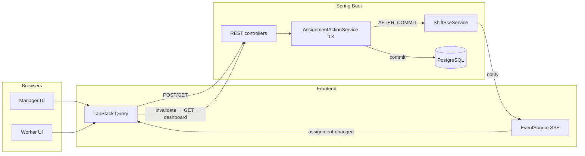

# Oloodi Live Staffing Dashboard

Live staffing demo for one seeded shift: a **Manager** invites workers; **Workers** accept/decline/cancel and check in/out. Updates sync over **Server-Sent Events (SSE)**; **REST remains authoritative**.

This is a coding-challenge submission (Phases 1–8). It is **not** a production staffing product.

| URL (Docker Compose) | URL (local dev) |
|----------------------|-----------------|
| Manager: http://localhost:3000/manager | http://localhost:5173/manager |
| Worker: http://localhost:3000/worker | http://localhost:5173/worker |
| API: http://localhost:8080 | http://localhost:8080 |

---

## Quick start (Docker — preferred)

```bash
cd Oloodi
docker compose up --build --wait  # postgres + backend + frontend
```

Wait until all services are **healthy**, then open the Manager/Worker URLs above.

| Service | Host port |
|---------|-----------|
| Frontend (nginx) | **3000** |
| Backend API | **8080** |
| Postgres | **5433** (avoids clashing with a local `:5432`) |

Compose uses `host.docker.internal` so containers reach published host ports (reliable when bridge container-to-container traffic is restricted). Demo CORS allows `:3000` and `:5173`.

**Reset demo data** (local/demo profile only — never production):

```bash
bash scripts/reset-demo.sh
# Windows PowerShell: curl.exe --fail --request POST http://127.0.0.1:8080/api/dev/reset
```

Run reset before each walkthrough. It restores the seeded shift to three required workers and the **current America/Montreal calendar day, 09:00–17:00**. The three seeded assignments return to `UNINVITED` / `NOT_STARTED` with empty check-in/out timestamps. Open live dashboards refresh automatically. The reset updates only the existing demo shift and its three seeded assignments, with no inserts or deletes. You can demo before 09:00 or after 17:00 because the workflow uses status-based eligibility.

Stop:

```bash
docker compose down
```

Demo credentials in Compose are intentional placeholders (`oloodi` / `oloodi`). See `.env.example`.

---

## Demo workflow (happy path)

1. Reset → all three workers `UNINVITED` / `NOT_STARTED`.
2. Manager invites **Sarah** → Worker accepts → check-in → check-out (watch Manager update **without refresh**).
3. Invite **Daniel**, accept, cancel, accept again.
4. Invite **Alex**, decline (final — cannot accept).
5. Optional: disconnect SSE / reconnect and confirm catch-up.
6. Confirm counts match rows (e.g. Sarah checked in, Daniel checked out, Alex declined → filled 2, remaining 1, in 1, out 1).

Full script: [`docs/DEMO_SCRIPT.md`](docs/DEMO_SCRIPT.md).

---

## Architecture



**ASCII (same idea):**

```
Browser mutation (REST)
  → DB commit
  → AFTER_COMMIT ApplicationEvent
  → SSE assignment-changed (notification only)
  → TanStack Query invalidate
  → GET /dashboard (authoritative)
```

SSE never patches UI state from the payload. On (re)connect, the client invalidates once for catch-up.

---

## Data model

| Table | Purpose |
|-------|---------|
| `workers` | Seeded people (Sarah, Daniel, Alex) |
| `shifts` | One demo shift (`required_workers = 3`) |
| `shift_assignments` | Participation + attendance + check timestamps + `@Version` |

- `UNIQUE (shift_id, worker_id)`
- Invite **updates** the existing seed row (never inserts a new assignment)
- Counts are **derived** in `DashboardCountsCalculator` (not stored)

Stable demo UUIDs: shift `11111111-…-1111`; assignments `…301` Sarah, `…302` Daniel, `…303` Alex.

---

## State machine

| From | Action | To |
|------|--------|-----|
| UNINVITED + NOT_STARTED | invite | INVITED + NOT_STARTED |
| INVITED + NOT_STARTED | accept | ACCEPTED + NOT_STARTED |
| INVITED + NOT_STARTED | decline | DECLINED + NOT_STARTED (**FINAL** — no decline→accept) |
| ACCEPTED + NOT_STARTED | cancel | CANCELLED + NOT_STARTED |
| CANCELLED + NOT_STARTED | accept | ACCEPTED + NOT_STARTED |
| ACCEPTED + NOT_STARTED | check-in | ACCEPTED + CHECKED_IN (`checkedInAt` once) |
| ACCEPTED + CHECKED_IN | check-out | ACCEPTED + CHECKED_OUT (`checkedOutAt` once) |

Already-in-target → **idempotent no-op** (timestamps unchanged). All other transitions → **409 ProblemDetail**.

**DECLINED is final:** once a worker declines, they cannot accept that assignment again (challenge assumption; cancel→accept remains available).

Temporal check-in windows are intentionally not enforced because the challenge defines check-in eligibility through participation and attendance state. A production system could additionally enforce a configurable check-in window relative to the shift start time.

---

## Tech choices — why / intentionally not used

| Used | Why |
|------|-----|
| Java 21 + Spring Boot 3 | Typed domain + TX boundaries; fits Oloodi’s Java/Spring world |
| PostgreSQL + Flyway | Durable assignments; deterministic seed |
| React + Vite + TS | Fast UI with typed API client |
| TanStack Query | Cache + invalidate on SSE; no Redux |
| SSE (`text/event-stream`) | One-way server→browser notify; simpler than WS for this |

| Intentionally **not** used | Why |
|----------------------------|-----|
| WebSockets | Duplex not needed; SSE + REST refetch is enough |
| JWT / auth | Out of challenge scope; demo is open |
| Redis / Kafka | Single-node demo; no fan-out need |
| Polling | SSE + reconnect catch-up instead |
| Idempotency-Key header | Natural idempotency in the state machine |
| Stored count columns | Avoid drift; derive from assignments |

---

## REST API

```
GET  /api/shifts/{shiftId}/dashboard
GET  /api/shifts/{shiftId}/assignments
GET  /api/shifts/{shiftId}/assignments/{assignmentId}
POST /api/shifts/{shiftId}/assignments/{assignmentId}/invite|accept|decline|cancel|check-in|check-out
GET  /api/shifts/{shiftId}/events          # SSE: event name assignment-changed
POST /api/dev/reset                        # local|demo|test profiles only
```

Errors: Spring `ProblemDetail` (400 / 404 / 409 / 500). No stack traces in bodies.

---

## Reliability

- Mutations are `@Transactional`; SSE publish is `@TransactionalEventListener(AFTER_COMMIT)`
- Broken SSE emitters removed without failing the mutation
- Comment-only heartbeats (~20s) — do **not** trigger refetch
- Optimistic `@Version` + 409 on illegal/stale conflict paths
- Frontend: on LIVE, mutation success skips duplicate invalidate (SSE owns one refetch); 409 always invalidates
- Reconnect: EventSource auto-reconnect + invalidate on open; E2E uses DEV `__oloodiForceSseDisconnect` for deterministic drops

---

## Counts & N+1

- `filled` = ACCEPTED assignments; `remaining` = max(required − filled, 0); `checkedIn` / `checkedOut` from attendance
- Dashboard load ≈ **2 SQL** queries: `ShiftRepository.findById` + `findAllByShiftIdWithWorker` (`@EntityGraph` worker+shift) — no per-row N+1

---

## Test commands

| Suite | Command |
|-------|---------|
| Backend (JDK 21, running Docker for Testcontainers) | `mvn verify` |
| Frontend lint, TypeScript and production build (from `frontend/`) | `npm run lint` and `npm run build` |
| Frontend unit (from `frontend/`) | `npm test` |
| Playwright E2E (from `frontend/`) | `npx playwright install chromium` then `npm run test:e2e` |

Playwright resets the seeded demo data before each test. Run it against a dedicated local database with the backend `local` profile and the Vite development server from the setup below. Defaults are `http://127.0.0.1:8080` for the API and `http://127.0.0.1:5173` for Vite. Override them with `E2E_API_URL` and `E2E_BASE_URL` when using different ports.

E2E covers Sarah lifecycle (no refresh), persistence reload, Daniel cancel→accept, Alex decline, API 409s, duplicate check-in/out timestamps, dual worker contexts, counts, reconnect catch-up, and `/api/dev/reset`.

---

## Performance (Phase 6 — local/demo only)

Measured on the **cloud agent VM** (`frontend/measurements/results.json`). **Not production claims.**

| Metric | median | p95 | n |
|--------|--------|-----|---|
| REST invite | 6.13 ms | 10.55 | 30 |
| REST accept | 5.16 ms | 10.27 | 30 |
| REST check-in | 6.39 ms | 16.67 | 30 |
| REST check-out | 3.46 ms | 7.13 | 30 |
| SSE after `occurredAt` (pre-commit-biased) | 2 ms | 5 | 25 |
| Live UI update (mutate → manager INVITED) | 30.51 ms | 32.67 | 25 |
| Reconnect → LIVE | 142 ms | 155 | 12 |
| Reconnect → correct UI | 145 ms | 159 | 12 |

```bash
# BE local profile + FE with VITE_API_BASE_URL required
cd frontend && npm run measure
```

`occurredAt` is stamped inside the TX before commit; SSE is AFTER_COMMIT — treat that delta as approximate.

---

## Local setup (Java 21, Maven, Node 24.15+, PostgreSQL 16)

```bash
# Postgres
export DB_URL=jdbc:postgresql://localhost:5432/live_staffing
export DB_USER=oloodi DB_PASSWORD=oloodi

# Backend (enables /api/dev/reset)
SPRING_PROFILES_ACTIVE=local mvn spring-boot:run

# Frontend
cd frontend && npm ci
VITE_API_BASE_URL=http://127.0.0.1:8080 npm run dev   # helpful for SSE under Playwright
```

For a local Maven run, create the `live_staffing` database and export the backend variables shown above with values for your PostgreSQL instance. For PowerShell, set them with `$env:DB_URL = '...'` and the same syntax for the other variables, then run `mvn spring-boot:run`. `.env.example` lists available environment variables.

**Testcontainers note (Docker 29):** if the client API is “too old”, set `"min-api-version": "1.24"` in `/etc/docker/daemon.json` and restart Docker.

---

## Challenges & limitations

- Open demo API without authentication or role enforcement. The Manager dashboard exposes Invite, and the Worker dashboard exposes worker actions, including Cancel.
- Single-node SSE registry (not multi-instance sticky/broadcast)
- Dev reset + CORS only on `local` / `demo` / `test`
- Tiny dataset; no pagination
- Reconnect E2E uses a DEV disconnect hook (native `route.abort` does not drop an open EventSource)

## Production improvements (not implemented)

AuthN/Z, multi-instance SSE (Redis pub/sub or broker), observability, rate limits, tighter CORS, managed secrets, CI gating, horizontal scale tests.

---

## Docs

| Doc | Purpose |
|-----|---------|
| [`docs/AI_USAGE.md`](docs/AI_USAGE.md) | What Cursor helped with; human decisions |
| [`docs/DEMO_SCRIPT.md`](docs/DEMO_SCRIPT.md) | 5–7 minute walkthrough |
| [`docs/INTERVIEW_QA.md`](docs/INTERVIEW_QA.md) | Likely interview questions |
| [`docs/architecture.md`](docs/architecture.md) | Short architecture notes |
| `docs/phase-*-*.md` | Phase reports |
| `frontend/measurements/` | Phase 6 raw numbers |

---

## Layout

```
Oloodi/
  src/                  Spring Boot backend
  frontend/             React + Playwright + measurements
  scripts/reset-demo.sh
  docker-compose.yml
  Dockerfile            backend image
  frontend/Dockerfile   nginx + static UI
  docs/
```
